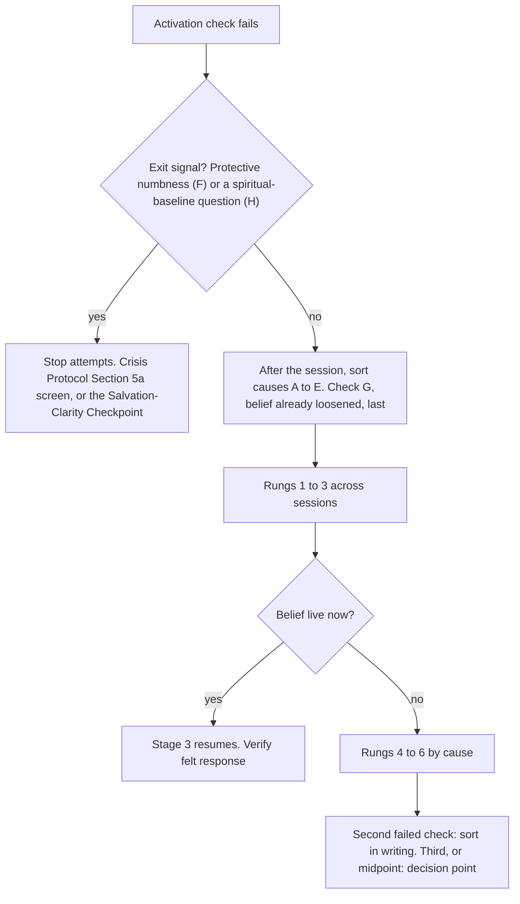

# Covenant Identity — When the Belief Will Not Activate — Practitioner Reference
*Practitioner Reference — what the coach does, in what order, and where the coach stops, when the false belief is not live in the room*

**What this is:** A practitioner reference for one situation. The coach has run the activation check from the [[Covenant Identity — Diagnostic Lens Transition Logic]], and the named false belief is not emotionally live. The client can describe it. The client does not feel it now. This document sorts the likely causes, sets out what the coach may do in order, draws the line between cueing a belief and manufacturing a response, and states where the coach stops.

**When used:** Any time the activation check fails. That means Stage 3 before covenant truth is spoken, the Activate step of the Parts & Burden worksheet, or a "Not activated" value that repeats in the session-prep and growth-notes fields. Do the sort in Section 4 after the session. During the session, use only the Rung 1 questions and presence.

**Who uses it:** Practitioner only. No client-facing content is derived from this document.

**Status:** Written before any live CIC session has used it. Items tagged [D] are CIC design judgment, not findings. The scope-boundary supervisor (priority 1 in the [[Covenant Identity — Pre-Practice Readiness Action Plan]]) should review them before they govern a live engagement. Section 11 lists what needs a ruling.

---

## The Short Answer

1. **A belief that is not live cannot be updated.** The research says retrieval comes first. It does not say how to produce retrieval in a person whose belief is not active. No source the vault holds tests a method for that in coaching. [E][T]
2. **The coach may cue. The coach may not manufacture.** Cueing brings the client's own material into the present. Manufacturing supplies, intensifies, or requires a response the client has not produced. [D]
3. **Sort the cause before choosing a move.** Eight causes produce the same picture in the room. Two of them can end the sequence: protective numbness, and a spiritual-baseline question. The other six call for different moves.
4. **Switching to Vision-Led is not an option.** It is an entry door for clients with no presenting cost. It has its own felt requirement, and the Transition Logic forbids using it as a shortcut.
5. **The options are slower, not stronger.** Return to a real recent episode. Take the noticing into daily life. Test the belief through a small behavior. Hold the targeted declaration. Keep running the formation work that does not depend on activation.
6. **Set a decision point.** Waiting is not a plan. At a stated point the coach reviews with the supervisor and chooses: continue with a named route, open the referral screen, or tell the client plainly where the work stands. [D]

---

## 1. What the Presentation Is

**The test.** The Transition Logic states the activation check this way: "Does the client have emotional, body-forward contact with the false identity right now, or are they reflecting on it from a distance?" This document applies when the answer is "from a distance."

**What it looks like.** Read these after the session. They are not an in-session checklist. The guard in the [[Covenant Identity — Stage 4b Implicit Level Practitioner Reference]] applies without change: a coach who is scanning channels is no longer present.

| Channel | Signs that the belief is not live |
|---|---|
| Verbal | Accurate description in the past tense or about "people like me." Explanation with "because." Recognition that is polite and does not extend to new contexts. |
| Paraverbal | Tone, pace, and volume do not change when the belief is named. |
| Body | Controlled presentation, flat affect, quick topic shifts, intellectualizing (defensive processing, the first AEDP state). No visible shift when truth lands, which the Soils framework lists as a path-soil sign. |
| Timing | The exchange runs smoothly and on schedule. There is no pause that neither party fills. |
| Coach's own body | Nothing shifts in the coach either. |
| Existing fields | Pattern activation this session: Minimal or Absent. Compared to last session: Not activated. |

Sources for the table: [[Covenant Identity — Implicit Signal Recognition Quick Reference]] (channels), [[Covenant Identity — Verifying Felt Juxtaposition — Mechanism & Practitioner Reference]] (smoothness and the coach's own body), [[A-Parable of the Soils — Kingdom Coaching Deep Framework]] (path-soil body signs), and [[Covenant Identity — Session Growth Notes Template]] (Section 5).

**What it is not.** Five presentations look similar and go elsewhere.

| Looks similar | The difference | Go to |
|---|---|---|
| Stage 4a | The client argues, reframes, or minimizes the truth. The belief is live as an argument. | Stage 4a tools in the Transition Logic |
| Stage 4b | Conditions 1 and 2 were met. Covenant truth met a live, named false structure. Nothing moved. | The Stage 4b response |
| Premature declaration | Covenant truth was spoken before the belief was live and named. | This document, then back to Stage 1 |
| Salvation-clarity signal | The client says some version of "I don't actually know if that's true of me." | [[Covenant Identity — Salvation-Clarity Checkpoint & Gospel Bridge Protocol]]. Pause Stage 2 to 4b tools. |
| Felt-presence complaint | The client reports no felt sense of God. That is not a missing reaction to a false belief. | [[Covenant Identity — Covenantal Permanence vs. Felt Presence — Practitioner Reference]] |

The sorting question comes from the [[Covenant Identity — What Moves Covenant Truth from Registration to Reception]]: *Did covenant truth meet a live, named false structure?* If no, this is premature declaration and this document applies. If yes and nothing moved, this is Stage 4b.

**How it relates to Condition 2.** Condition 2 is the felt cost of the false structure. Activation is the belief itself being live. They are usually missing together. The Transition Logic says to "Stay in Stage 1 (Affections). Deepen the felt sense of what the dependency costs." The Registration document says that when Condition 2 is missing, "the coaching move is not more affections mapping — it is lament." This document reads the two as one move: deepen the felt cost through the lament question, not through further mapping of the pattern. [D]

---

## 2. What Is Known About Reactivating a Belief That Is Not Live

Claims in this section carry the same four tags as the [[Covenant Identity — Image-Protective Patterns (Narcissistic Patterns) — Practitioner Reference]].

| Tag | Meaning | May ground a scope or referral decision? |
|---|---|---|
| [E] | Research-established. Published in a primary source. | Yes |
| [T] | Theory. Influential, built largely from clinical observation or models. | Not alone |
| [P] | Practitioner observation not traced to a primary source. | Never |
| [D] | CIC design judgment. An inference made for this model. | Only after supervisor review |

**2.1 Retrieval comes first.** In rats, a drug that blocks memory re-storage did nothing when the memory had not been reactivated first (Nader, Schafe and LeDoux, 2000). A memory that is not retrieved is not opened for change. [E, animal only]

**2.2 Retrieval is not enough.** The reactivated memory also has to meet something it did not predict. If retrieval matches what the memory expects, the memory can re-store unchanged (Pedreira et al., 2004; Ecker, Hulley and Hulley, 2012). This is why a calm description of the belief, followed by a well-matched declaration, tends to add a second proposition without changing the first. [E in animals; T in clinical translation]

**2.3 The human evidence is contested.** The best-known human result (Schiller et al., 2010) was not confirmed by a 2020 verification report and a registered replication (Chalkia et al.). A 2018 critical review calls human reconsolidation a viable but contested account (Elsey, Van Ast and Kindt). Nothing in this document depends on the laboratory result. It depends on the clinical observation that assent without reception is common. [E for the dispute; P for the observation]

**2.4 Strong, old memories are the hardest to open.** Reviews report that memory strength and age act as boundary conditions on destabilization. The authors of one review argue the limits are not absolute (Elsey and Kindt, 2017). [E, abstract-level] The beliefs CIC works with are usually old and strongly held. Design implication: expect slow movement through repeated return. Do not read one failed activation as a reason to press harder in the same session. [D]

**2.5 The three-ingredient account says what change needs. It does not say how to get reactivation.** Lane, Ryan, Nadel and Greenberg (2015) propose that many therapies work through three ingredients: reactivating the old memory, a new emotional experience incorporated through reconsolidation, and reinforcement of the integrated memory by practice. [T] The abstract describes the model. It names no method for producing reactivation in a person whose memory is not active. The full text was not read.

**2.6 Beliefs depend on cues, and defenses can keep them dormant.** The [[Covenant Identity — Identity vs. Trigger-Activated Content — Psychological Frameworks Reference]] supplies four pieces:
- A trait is a stable tendency. A state is what the person is in now (Spielberger).
- A self-schema is chronically accessible, and it is still content (Markus).
- Compensatory strategies are the behaviors a person builds to avoid ever activating a core belief. They are why a core belief can lie dormant "for long stretches" (Beck). Avoidance is one of three coping styles (Young).
- A triggered state pulls retrieval toward matching content (Bower). A calm state pulls toward calm content.

[T, with application as D] Design implication: a calm conversation in a safe room is a poor setting for a belief that lives in particular triggers and behind particular defenses. Absence in the room is not absence in the life.

**2.7 Some people cannot produce felt access on request.**
- A lasting difficulty identifying and describing one's own feelings (alexithymia) is found in roughly one adult in ten in general-population studies. Estimates run from about 6% to 20%, depending on the sample and the cutoff. Two studies using the same scale found about 10% in Germany and 13% in Finland. [E, abstract-level]
- Adults with an avoidant attachment style tend to use deactivating strategies. They minimize and suppress emotion (Mikulincer and Shaver). [T, with a large correlational base]
- Numbness can be protective after trauma. Section 5a of the [[Covenant Identity — Crisis & Referral Protocol]] describes this as a flat tone while narrating painful content. [T]

The coach does not assess any of these. The point is narrower. When the room produces no feeling, the coach cannot tell from the room which of these is operating. That is why this document says sort first, then act. [D]

**2.8 What the vault already documents for activating a belief.** Four moves, all cueing, none tested in coaching:
- Ecker's discovery step. Locate the belief's internal logic by asking what it protects or means, until the emotional truth is felt and not only named.
- The Parts & Burden Activate step. Ask for "a recent, clear example — not the most painful memory," then where the client feels it in the body.
- Tool 19. Attend, find a handle, check. "Nothing happening" is information, not failure.
- Stage 1. Deepen the felt cost. [D, T]

**2.9 What is not known.** No source in the vault tests any method for bringing a not-live belief into contact in a coaching context. The checks logged on 2026-10-22 found none either. A systematic literature search has not been run. Every method in Section 5 is therefore [D]. Also unchecked: whether training in attention to bodily felt sense raises a client's capacity over time. Tool 19 says it does. The Hendricks review, which the Stage 4b Source Log cites for the link between experiencing level and outcome, also takes up whether clients can be taught. Its answer was not read.

---

## 3. Cueing, Not Manufacturing

**The line.** The coach may bring the client's own material into the present tense. The coach may not supply, intensify, or require a response the client has not produced. [D]

**Why the line sits here.** Four documents already commit to it.
- The [[Covenant Identity Coaching — Theory of Change]], Node 6: "Manufactured activation is not the Spirit's witness; does not reorganize the implicit level." Romans 8:16 (ESV): "The Spirit himself bears witness with our spirit that we are children of God." The coach creates conditions. The witness is not the coach's to produce.
- The [[Covenant Identity Coaching — The Promise (Client-Facing)]] tells the client: "if you ever feel like I'm pushing you toward a feeling rather than waiting with you for something real, tell me. That's a signal something's off, not a sign the process needs more pressure." Manufacturing a response breaks that promise.
- Stage 4b Route B: "any signal — tone, pacing, a follow-up question — implying the client should have produced something by now" confirms the exact belief the sequence exists to disconfirm.
- The Transition Logic's category errors: pressing a client to perform a distress narrative they do not have is "spiritually corrosive in a specific way."

A client who says "I feel nothing" is also being honest. The standing lament caution in the [[Covenant Identity Coaching — Theological-Formation Contributor Stack]] (Layer 11) applies here: an honest nothing is not a problem to answer with a declaration.

**Three questions before any activation move.** [D]
1. Is the material the client's? Their words, their episode, their body response. Not the coach's interpretation, image, or feeling-word.
2. Is "nothing" a complete answer? If the client cannot say "nothing" and have it accepted, the move is pressure.
3. Is this a repeat? If the same move is being tried again with more force because it did not work, stop and sort instead.

| Do (cueing) | Do not (manufacturing) |
|---|---|
| Ask for the most recent real instance: "Not the worst time, just the last one." | Repeat the question with more force, or in new forms, until something comes. |
| Ask what happened just before, what the client did, and what the client avoided. | Name the feeling or the wound for the client when the client has not. |
| Read back, once and without comment, a sentence the client used at intake. | Use the client's most painful memory to get a reaction. |
| Ask one open attending question and wait: "What do you notice happening in you right now?" | Read Scripture or a declaration aloud to warm up a response. |
| Let silence run when it is processing silence. | Use silence, eye contact, or tone as pressure. |
| Receive "nothing" as information. | Rate the response aloud ("you're not really feeling it") or label the client blocked, in denial, or resistant. |
| Name a trigger the client has already given. | Offer a source for the belief (a person, a childhood scene) the client has not named. |

**The check is private.** The coach does not announce that the belief "isn't live." The coach keeps the session moving with the next question and records the read afterward.

**Body-attending and a scope question.** One open question, asked once, is the form Route B (Step 1, Attend) and the Parts & Burden worksheet (Section 1) already use. Sustained direction of the client's attention to a body sensation is the form that Section VII of the Stage 4b reference lists as out of scope. The vault does not draw the line between them exactly. This document treats a single open question as in scope and sustained directing as out. That reading needs the supervisor's ruling (Section 11, item 1). [D]

---

## 4. Sort the Cause First

Several causes produce the same picture in the room. Screen out F and H first, because they can end the sequence. Work A to E next. Check G last, because it is the explanation easiest to accept too early. Causes co-occur, so sort for the primary cause and revise as sessions add evidence. [D]

| Cause | What the coach sees | First move | If it persists |
|---|---|---|---|
| **A. Wrong target.** The named belief is not the live driver. | Recognition is polite or passive and does not extend to new contexts. The client's own words for the pattern differ from the coach's. Energy appears elsewhere in the session. | Return to Stages 1 and 2. Ask behavior questions before belief questions. Follow the energy. Re-run the completion test in [[Covenant Identity — From Vague to Specific — Condition 1 Practitioner Technique]]. Recheck "Before Typing" in the [[Covenant Identity — Character Wound Diagnostic Tool]]. | Log it as a naming call in the [[Covenant Identity — Diagnostic Calibration Log]]. Bring it to supervision. |
| **B. Wrong setting.** The belief lives in triggers the room does not contain. | The client describes strong, specific reactions outside the session and is calm inside it. Or the client cannot recall a recent instance. | Ask for the last instance. Bring in the concrete trigger the client gave: the message, the scene, the person. Then use Rung 3, the in-life noticing assignment. | If two weeks of noticing produce no episode, suspect A. If the client has no presenting cost at all, see Section 6. |
| **C. Container not yet safe.** Disclosure still feels risky. Hard (path) soil, an early alliance, or Hermit-type compliance. | Guarded, brief, cooperative but flat. Immediate intellectualizing. "Fine." Quick topic shifts. Agreement with no sense of having been reached. | Slow down. Build the container through alliance work, pacing, and the anchor in [[Covenant Identity — Resourcing & Anchor Establishment — Practitioner Reference]]. Receive small disclosures without asking for more. Do not push. | This is time-dependent. Apply the review points in Section 7.3. Watch for the early-Phase-1 misread in Section 6. |
| **D. A defense is the live material.** A standing strategy keeps the belief dormant: busyness, humor, competence, contempt, spiritualizing. | The defense is vivid and the belief is not. Polished spiritual answers. Contempt that covers shame. Insight packaged into a lesson. | Treat the protector as the live material. Ask what it does for the client: "What would you lose if you no longer believed this about yourself?" Name the pattern as an observation. Do not argue with it. See Sections 2 and 3 of the Parts & Burden worksheet. | If the pattern plays out with the coach, move to Stage 4b Route A. Stop Parts work if the client loses all observer distance. |
| **E. Low emotional access as a trait.** A lasting difficulty identifying and describing feelings (alexithymia), or an emotion-minimizing style (avoidant deactivation). | Genuinely stuck on "How do you usually know when you're upset?" Feeling words are rare. Behavior and circumstance are described easily. | Use situation and behavior language, not feeling language. Use Rung 3 with observable events. Use Rung 5, a small behavioral test. | Screen against Crisis Protocol Section 5a, because the signal overlaps with F. Accept that some clients will not reach felt contact within an engagement. |
| **F. Protective numbness.** Feeling is switched off for a reason that may be trauma-related (dissociation). Can end the sequence. | Flat affect while narrating painful content. Unflagged time gaps. Depersonalized language ("you just kind of check out"). Minimizing paired with content that is not minor. Unexplained physical complaints. | Stop activation attempts. Ground if needed. Listen across the six domains in Crisis Protocol Section 5a over the next sessions. Do not tell the client they have trauma. | A pattern in two or more domains, held over more than one session, opens the Crisis Protocol Section 5 referral conversation. |
| **G. The belief has already loosened.** There is nothing to activate. | The client says the old reaction rarely fires. Brought to mind, it feels flat, distant, "no longer gripping." Behavior under pressure has changed. | Verify with Layer 2 of the [[Covenant Identity — Verifying Felt Juxtaposition — Mechanism & Practitioner Reference]]. Log it. Move to consolidation or Phase 4. | "It doesn't bother me" can describe suppression. Check behavior under stress. Under stress, a belief that was only overridden returns. |
| **H. A spiritual-baseline question.** Can end the sequence. | "I don't actually know if that's true of me." Present-tense talk of becoming a Christian that persists well into the engagement. | Pause Stage 2 to 4b tools. Open the Salvation-Clarity Checkpoint & Gospel Bridge Protocol. | Follow its three outcomes. |

Rows C and D draw on the Soils framework, the Hermit section of the Character Wound tool, and the secondary-affect section of the Verifying Felt Juxtaposition reference. The worked example "Renee K." in the [[ALLc — Covenant Identity — Worked Session Examples — Index]] shows cause D: a fluent, cooperative client whose polished answers risk being read as engagement. The spiritual-bypassing cluster in the [[Covenant Identity — Poor Relational Support Practices — Practitioner Diagnostic Reference]] names the same pattern in helpers.

---

## 5. The Option Ladder

The ladder runs from least to most demanding. It is a default order, not a script. Rungs 0 to 3 can run across a few sessions. Do not use Rungs 4 or 5 until the sort has ruled out F. Rung 6 runs alongside the others. [D]

**Rung 0 — Check your own read.**
- Is the belief not live, or is the response quiet and slow? The Character Wound tool says of the Hermit, "The Hermit's slowness is not resistance; it is the cost of safety being built."
- Apply Layer 1 of the Verifying Felt Juxtaposition reference. A fluent, well-organized response is not evidence of a felt one, in either direction.
- Name your own pull. An urge to fill the silence, to rescue, or to push is data. Record it in the [[Covenant Identity — Self-Supervision Template]].

**Rung 1 — Stay in Stage 1 and go to a real, recent episode.** This is the documented instruction.
- "Tell me about the last time this happened. Not the worst time. Where were you, who was there, what happened?"
- Ask what happened just before, and what the client did or avoided.
- Ask the Condition 2 question: "What has it cost you to live this way? Not what you know it costs — what you actually feel it has cost you."
- Ask one attending question, once: "What do you notice happening in you right now — not what you think, what you actually notice?"
- Wait. Accept "nothing."
- Limit: two tries in one session. Do not make a third.

**Rung 2 — Re-open the target.** Ask whether the named belief is the one that is live. Offer the tentative name and let the client correct it. Run the three-question completion test from the Condition 1 technique. If the client's energy is somewhere else, follow it. (Cause A.)

**Rung 3 — Take it into daily life.** Assign noticing, so the next session starts from a fresh episode. [D, built on the shape of an existing practice]
- The shape. One open question, once or twice in the week, brought back verbally and never submitted as a form. The [[ALLk — Covenant Identity — Externalization Noticing Practice]] sets this shape because a gradeable instrument invites performance.
- The frame. Noticing asks "what is present?" Processing asks "what does this mean?" The [[ALLa — Covenant Identity — Between-Session Library — Design Rationale]] calls this the load-bearing frame, and says it must be given in session.
- Sample wording: *"This week, if you catch that reaction starting, don't fix it. Just notice where you were and what happened right before. One sentence is enough. We'll start there next time."*
- For Cause E, ask for events and behavior, not feelings.
- Watch for performed noticing. The ALLk practice names this risk in its fifth instruction.

**Rung 4 — The felt-sense route, held loosely.** Use it only when the client is regulated, the alliance is stable, and no Crisis Protocol Section 5a pattern is present.
- Route B Steps 1 to 3 (Attend, Handle, Resonate), or the Activate step of the Parts & Burden worksheet. [[19 — Felt Sense Focusing]] is the client's between-session version.
- If nothing surfaces, the Route B text says "stay here — do not push to the next step." An unanswered ask is a complete outcome.
- Tool 19 on nothing happening: "This is not failure ... Bring the experience of nothing-coming to your next session — that is information too."
- Stop at once on the signals in Section 7.2.
- Route B has not been used in a live session. Treat it as untested.

**Rung 5 — Reach the belief through behavior.** For clients with low felt access, and for any client who can state the belief as "if X, then Y."
- Use a small test the client designs: the Big Assumption Experiment in [[Five Intervention Modalities — Definitions & Deep Elaboration]], or the behavioral experiment among the Stage 4a tools. Small, specific, time-limited, low-stakes, and data-generating.
- The logic. Ecker's list of what counts as juxtaposition includes "Behavioral: the predicted outcome does not occur while the fear is live." The test puts the client in the situation where the belief is live. The coach does not have to produce activation in the room. [T, D]
- Debrief with the felt question first: "What happened in you when you did it?" Then: "What does that tell you?"
- Limit. The test must be survivable. Never design a test around a safety risk such as an abusive person or a dangerous setting. If the feared outcome is a safety matter, stop and go to the Crisis & Referral Protocol.
- Untested. No source shows that a behavioral test reaches the felt level. The five-modalities reference says one experiment "rarely demolishes" a Big Assumption. Treat the first as data.

**Rung 6 — Run the work that does not depend on activation. Hold the targeted declaration.**
- Continue the receptive posture and silence (Condition 3), the disciplines, Scripture saturation, lament, and resourcing. None of these claims to rewrite the belief.
- Hold the Stage 3 targeted declaration. Spoken into a belief that is named but not live, it produces extinction-mode processing: a "parallel track" that returns under stress (Registration document, mechanism 3; [[Covenant Identity — Matched Declaration Architecture]], step 2 of the deployment protocol).
- Tell the client why, in plain words. *"I'm holding off on the declaration for now. Said before the belief is alive in you, it would only sit beside it. I would rather wait until it can reach the place that needs it."*
- Do not present this as a consolation. Do not let the client conclude they are failing at formation.

**Rung 7 — The decision point.** See Section 7.3.

**Not the answer.**
- *Healing prayer.* The criteria are narrow: truth cognitively received across multiple sessions with no felt movement, affect present but arrested, explicit tools exhausted, and the client has asked for prayer unprompted ([[Covenant Identity — Practitioner Qualities & Skills for the Work]]). Non-activation means affect is absent, not arrested. The case does not fit.
- *Moving to Vision-Led.* Section 6.
- *Declaring anyway "to plant a seed."* Rung 6.
- *Pressing harder.* Section 3.

---

## 6. Vision-Led Is Not a Fallback

**What it is.** One of two doors into Stage 1. The [[Covenant Identity — Wound-Led vs. Vision-Led — Architecture at a Glance]] calls it "one diagnostic engine, two front doors." The Vision-Led door is for a client with no presenting cost who wants to grow deeper and is willing to be diagnosed.

**What it asks.** The same felt requirement. Condition 2-Alt is "a specific, *felt* gap between who the client wants to become and who they currently are: longing or holy dissatisfaction, not grief." The Transition Logic adds that if the desire is only intellectual assent to self-improvement, "Condition 2 is not yet met, and the coach should continue Vision-Led Stage 1."

**What it forbids.** "Do not use Condition 2-Alt as a shortcut for a Wound-Led client who is simply resistant to feeling grief; that is a different diagnostic picture." Moving a Wound-Led client who will not activate to the Vision-Led door is exactly that shortcut.

**What it warns about.** The Transition Logic names the opposite misroute: "A client who is genuinely hurting but hasn't yet found language for their cost — common early in Phase 1, before trust is established — can present as if they have no presenting cost." That is Cause C in Section 4. A guarded client looks Vision-Led.

**What it leaves out.** The Entry Fork is read once, at the Discovery Call or early Phase 1. The vault documents one reroute, from Vision-Led to Wound-Led (the Lateral Reroute Signal). It documents no reroute the other way.

**When the fork was misread.** If the evidence shows the Entry Fork was misread at the Discovery Call, re-read it deliberately with that evidence. Log it as a routing call in the Calibration Log and review it with the supervisor. Do not use the re-read to exit a failed activation. [D]

**If a Vision-Led client does not activate.** The target is the felt gap. Continue Appetite Discovery. Check the Lateral Reroute Signal: compulsive growth-seeking, a performed discipline, or anxiety about the diagnostic process itself all point back to the Wound-Led door.

---

## 7. Scope, Stop, and Referral

### 7.1 What is in scope

| In scope | At the boundary | Out of scope |
|---|---|---|
| Asking for a recent real instance. Asking what happened and what the client did. One open attending question. Silence. Reading the client's own words back. Noticing assignments. Small client-designed behavioral tests. Building the container. | Naming an observed body signal ("I notice your shoulders dropped just now"), as observation only. A body-attending sequence longer than one question (Section 11, item 1). | Bringing up trauma memories to produce a reaction. Having the client re-enter a frightening scene. Continuing when affect escalates or the client dissociates. Directing sustained attention to a body sensation as the primary method. Processing early childhood relational trauma. Pushing toward material the client is avoiding (exposure work). |

Source: Section VII of the Stage 4b Implicit Level Practitioner Reference, applied here.

### 7.2 Stop at once

No counting. Stop the activation attempt when any of these appears. The sources are the Route B stop rule, Section VIII of the Stage 4b reference, and Sections 3 and 4 of the Crisis & Referral Protocol (acute trauma response, and the grounding steps).
- Activation escalates instead of settling.
- Affect flattens into a glazed or absent presentation.
- The client loses all observer distance and becomes the part instead of watching it.
- Dissociative features, flashback-like experiences, or somatic activation that escalates.

Then: stop the sequence. Drop to presence with no further invitation. Ground if needed (the 5-4-3-2-1 sequence, feet on the floor, slow breathing). Do not return to the material in that session. Document it. Apply the referral signals.

### 7.3 Review and decision points [D]

A *failed check* is a session in which the activation check was run and the belief was not live.

| Point | What the coach does |
|---|---|
| First failed check | Rungs 1 and 2 within the session. Record the sort letter in the notes. |
| Second failed check (any two sessions) | Within 24 hours, sort in writing using Section 4. Log the call in the Calibration Log. Change the approach. Do not repeat the same prompt. |
| Third failed check, or the engagement midpoint if two checks have failed, whichever comes first | Decision point. Review with the scope-boundary supervisor. Ask the client for their read. Choose and record one: (a) continue with a cause-specific route and a named review date; (b) run the Crisis Protocol Section 5a listening layer and, if its threshold is met, open its Section 5 referral conversation; (c) tell the client plainly where the work stands and agree what the remaining sessions are for. |

The numbers are placeholders. They are chosen to force a decision while sessions remain. They are not evidence-based, and the supervisor sets them. The Coaching Agreement states 12 sessions. The session tools label Phase 4 as sessions 8 to 10. The rule is tied to the midpoint and to failed checks for that reason, not to a session number.

### 7.4 The plain conversation (option c)

*"We've looked a few times for where this belief shows up when we're together, and it hasn't come alive here. I don't want to press you toward a feeling that isn't there. I told you at the start I wouldn't. Here is what I think may be going on. Here is what we could do with the sessions we have left. What's your read?"*

The conversation offers options. It asks for the client's read. It does not blame the client or the method, and it does not promise a result.

### 7.5 When non-activation becomes a referral question

Non-activation alone is not a referral trigger in the vault. The triggers are the existing ones:
- A pattern across two or more Crisis Protocol Section 5a domains, held over more than one session.
- Escalation, flooding, or dissociation during an activation attempt.
- Functional impairment (Stage 4b reference, Section VIII).

At the decision point the coach runs the screen. The screen decides. The coach does not infer trauma from non-activation alone. [D]

---

## 8. What to Record

- **Session Growth Notes, Section 5.** Pattern activation this session: Minimal or Absent. Compared to last session: Not activated. In the notes line, add the sort letter or letters and the rung used.
- **Session Prep Template.** The "Trend from previous session" field takes the same value, and carries the sort forward to the next session.
- **Diagnostic Calibration Log.** Log the sort as a call. Close it out when a later session shows which cause it was, including when activation finally occurs. Section 11, item 6, notes that the Log's text may need one line added.
- **Self-Supervision Template.** Record your own pull: the urge to push, rescue, or fill silence.
- **Supervision.** Bring any session that reached the second failed check.

---

## 9. Failure Modes

**Treating non-activation as resistance or failure.** The Stage 4b reference states the opposite premise: the client is "always on the side of their own healing, even when they appear to resist." Find where the Spirit is already moving. Stay close to it.

**Pressing harder.** The pull to speak or push at a quiet moment "comes from the practitioner's own discomfort with stillness — it is not a clinical signal" (Registration document). Manufactured activation is not the Spirit's witness.

**Declaring anyway.** It produces a second proposition beside the first and a client who believes the work is going well.

**Using Vision-Led as the exit.** It reroutes the diagnosis to avoid the finding.

**Accepting G too early.** "It doesn't bother me" is the easiest explanation to accept and the hardest to verify. Check behavior under stress.

**Turning the sort into an in-session checklist.** Sort after the session. During the session, ask the Rung 1 questions and stay present.

**Waiting indefinitely.** Patience can become avoidance on the coach's side. The decision point exists for this.

**Inferring trauma from non-activation.** The Crisis Protocol's threshold is a pattern across domains over time, not one absent reaction. The label, if it is ever spoken, belongs to a clinician.

---

## 10. Anticipated Critique

**Critique 1 — "Cueing is a polite word for manufacturing."**

*Steelmanned form:* Any question that asks for a felt response applies pressure. Asking for the last instance, then asking what the client notices, is a step-by-step way to produce a feeling.

*Response:* The test is not whether the coach asks. The test is whether the material is the client's and whether "nothing" is a respected answer (Section 3). A coach who accepts "nothing" and moves on has not manufactured anything. A coach who asks again, harder, has.

*Remaining exposure:* The line is a judgment. A coach with a stake in the session producing a result can cross it without noticing. Supervision of recorded or transcribed sessions is the control. The vault does not yet record one in place.

**Critique 2 — "Waiting for activation is permission to do nothing for a paying client."**

*Steelmanned form:* The engagement is 12 sessions at a fixed fee. A rule that holds the main intervention until a condition is met can leave the client with weeks of preparation and no work.

*Response:* Section 5 lists work that proceeds without activation: re-sorting the target, in-life noticing, a behavioral test, and the formation practices. The decision point forces a conversation while sessions remain.

*Remaining exposure:* The numbers are untested. The Coaching Agreement has no wording for a mutual decision to change what the remaining sessions are for (Section 11, item 4).

**Critique 3 — "If human reconsolidation is contested, why build a gate on it?"**

*Steelmanned form:* The activation requirement rests on a mechanism the best-known human study failed to replicate. A gate built on it may delay a useful intervention for no reason.

*Response:* The gate does not depend on the laboratory paradigm. The Value Case states that the caution against confusing assent with reception "is also common clinical experience, so the practice does not stand or fall with one laboratory paradigm." The gate also costs little: it delays one intervention and leaves the others running.

*Remaining exposure:* "Common clinical experience" is [P]. It cannot ground a referral decision, and nothing in Section 7 rests on it alone.

---

## 11. Open Items — Needs a Ruling or a Test

1. **Scope reading of body-attending.** Section VII of the Stage 4b reference lists "directing the client to 'stay with the sensation and notice what happens'" as out of scope. Route B (Section IV) and the Parts & Burden worksheet (Section 1) ask body-attending questions. This document reads one open question as in scope and sustained directing as out. The scope-boundary supervisor should rule. Route B has not been used in a live session.
2. **The stop-rule numbers.** Two failed checks to sort in writing, and three failed checks or the midpoint to decide, are placeholders.
3. **Wound-Led to Vision-Led re-read.** The vault has no procedure for it. Section 6 proposes a minimum: evidence, a logged routing call, and supervisor review.
4. **The Coaching Agreement.** It covers a client-chosen early end (unused sessions become credit) and coach-initiated termination for clinical scope (unused sessions refunded). It has no wording for a mutual decision to change what the remaining sessions are for. Check whether it needs any.
5. **Rung 5 (behavioral test) as a route to the felt level.** No source shows it works. Whether the supervisor and any clinical consultant would place it inside coaching scope has not been asked.
6. **The Diagnostic Calibration Log.** It covers Stage 4a/4b calls, Route A/B calls, and routing calls (the injury test, Pattern Origin versus the wound arc, the wound-type call). It has no category for the cause-sort made here. This document asks the coach to log the sort as a routing call. The Log's text may need one line added.
7. **Evidence.** No coaching-context test of any activation method was found. Lane et al. (2015), the alexithymia figures, the attachment research, and the reconsolidation boundary conditions were checked at abstract level only. Whether Focusing-type training raises a client's capacity over time was not checked.

---

## Connects To

| Document | Direction | What flows | Category error to avoid |
|---|---|---|---|
| [[Covenant Identity — Diagnostic Lens Transition Logic]] | ← inbound | The Stage 3 activation check and the instruction to stay in Stage 1. This document expands that one instruction. | Treating this document as a new stage. It is the detail behind one line of Stage 3. |
| [[Covenant Identity — What Moves Covenant Truth from Registration to Reception]] | ← inbound | Conditions 1 and 2, the extinction mechanism, and the premature-declaration versus Stage 4b test. | Using Condition 2 grief as the only reason a belief is not live. Several causes exist. |
| [[Memory Reconsolidation — Ecker & Neuroscience Basis]] | ← inbound | Retrieval, prediction error, Ecker's discovery step, the failure modes. | Reading the animal result as proof that conversation can open a human memory. |
| [[Covenant Identity — Identity vs. Trigger-Activated Content — Psychological Frameworks Reference]] | ← inbound | Dormant beliefs, compensatory strategies, state-dependent retrieval. | Treating a triggered state as evidence about identity. |
| [[Covenant Identity — Stage 4b Implicit Level Practitioner Reference]] | ↔ both | Route B, its stop rule, the scope boundary and referral signals flow in. The cause-sort flows out as the step before Stage 4b. | Running Stage 4b response on a belief that was never live. |
| [[Covenant Identity — Verifying Felt Juxtaposition — Mechanism & Practitioner Reference]] | ← inbound | Telling a felt response from a described one; Layer 2 verification for Cause G. | Accepting fluency as activation. |
| [[Covenant Identity — Wound-Led vs. Vision-Led — Architecture at a Glance]] | ← inbound | Condition 2-Alt and the misroute warnings. | Using the Vision-Led door as an exit. |
| [[Covenant Identity — Crisis & Referral Protocol]] | → outbound | Its Section 5a listening layer, its Section 5 referral conversation, and its grounding steps (Section 4). | Inferring trauma from non-activation alone. |
| [[Covenant Identity — Salvation-Clarity Checkpoint & Gospel Bridge Protocol]] | → outbound | Cause H. | Treating "I don't know if it's true of me" as a felt-sense barrier. |
| [[Covenant Identity — Diagnostic Calibration Log]] | → outbound | The cause-sort logged as a routing call. | Logging the sort as a Stage 4b call. |
| [[Covenant Identity — Covenantal Permanence vs. Felt Presence — Practitioner Reference]] | ↔ both | Sorts the "I can't feel God" complaint, which this document does not cover. | Applying this document to a felt-presence complaint. |

---

## Document Provenance

**Why this exists:** The Transition Logic gives one instruction for a belief that will not activate: "Stay in Stage 1." The Parts & Burden worksheet and the Registration document add a few moves. Nothing sorts the causes, draws the line between cueing and manufacturing, or says when to stop. The Value Case states that the practice "waits until the belief is felt before it speaks truth to it." This document says what the practice does while it waits.

**Governing question:** What may a non-clinical coach do, in what order, and where must the coach stop, when the false belief is not live in the room?

**Primary contributors:**

| Contributor | Specific contribution | Where it lives in the vault |
|---|---|---|
| Nader, Schafe and LeDoux | Retrieval before change (animal) | Memory Reconsolidation — Ecker & Neuroscience Basis |
| Ecker, Hulley and Hulley | Discovery step, juxtaposition, verification, failure modes | Memory Reconsolidation — Ecker & Neuroscience Basis |
| Lane, Ryan, Nadel and Greenberg | The three-ingredient account | The Value Case, Part II, evidence register row 12 |
| Beck, Young, Bower, Spielberger, Markus | Dormant beliefs, compensatory strategies, state-dependent retrieval | Identity vs. Trigger-Activated Content |
| Gendlin; McMahon and Campbell | Felt-sense attending; nothing-coming is information | Stage 4b reference; Tool 19 |
| Fosha | The defensive-processing state as a read of non-activation | Stage 4b reference |
| Kegan and Lahey | The Big Assumption Experiment | Five Intervention Modalities |
| Herman; van der Kolk | The six-domain listening layer for trauma a client does not name | Crisis & Referral Protocol, Section 5a |
| Mikulincer and Shaver | Deactivating strategies in avoidant attachment | Outside the vault; Source Log |
| Willard | Vision-first formation, behind Condition 2-Alt | Diagnostic Lens Transition Logic |

**Design decisions:**
- *Sort before act.* The same picture in the room has eight causes, and the right move differs. Two causes can end the sequence. Acting before sorting risks pressing a client who is numb.
- *Cueing versus manufacturing as the governing line.* The vault already forbids manufactured activation in four places. This document makes the line usable by giving three questions and a do/do-not table.
- *A ladder, not a protocol.* The order runs from least to most demanding. A protocol would invite the coach to execute it instead of reading the client.
- *Hold the declaration, keep the formation work.* The mechanism warns against declaring into a belief that is not live. It does not warn against Scripture, silence, lament, or the disciplines.
- *Numbers as placeholders.* A decision point without numbers would not force a decision. The numbers are flagged because no evidence sets them.
- *The two instructions read as one.* The Transition Logic says deepen the felt cost in Stage 1. The Registration document says the move is lament, not more mapping. This document reads them as the same move in different words.

**Scope boundary:** This document covers the activation check and what follows when it fails. It does not cover Stage 4b response, the Stage 4a tools, the referral conversation itself, or the salvation-clarity conversation. Each has its own document.

**Client summary:** Practitioner-only. Not shared with clients. The client-facing commitment it serves is in [[Covenant Identity Coaching — The Promise (Client-Facing)]].

**Contested ground:** The activation requirement rests on a reconsolidation model whose human evidence is contested (Section 2.3). The cause-sort, the cueing line, the ladder, and the stop rule are design judgment and have not been tested in a coaching context. The behavioral route (Rung 5) and the felt-sense route (Rung 4) are extensions of existing documents, not independently established methods.

---

## Source Log

| Source | Evidence level | Relevance |
|---|---|---|
| Nader, K., Schafe, G.E. & LeDoux, J.E. (2000). *Nature*, 406, 722–726. | Supported (animal) | Retrieval before change; no effect without reactivation. |
| Pedreira, M.E. et al. (2004). *Learning & Memory*, 11, 579–585. As listed in the Memory Reconsolidation document. | Supported (animal) | Mismatch between expected and actual outcome. Not read in this pass. |
| Ecker, B., Hulley, R. & Hulley, L. (2012). *Unlocking the Emotional Brain.* Routledge. | Supported / Theoretical | Discovery step, juxtaposition, verification, failure modes. |
| Chalkia, A. et al. (2020). *Cortex*, 129, 496–509 and 510–525. | Supported (as a challenge to Schiller 2010) | Human result not confirmed. |
| Elsey, J.W.B., Van Ast, V.A. & Kindt, M. (2018). *Psychological Bulletin*, 144(8), 797–848. | Supported (as a review) | Human reconsolidation viable but contested. |
| Elsey, J.W.B. & Kindt, M. (2017). Breaking boundaries: optimizing reconsolidation-based interventions for strong and old memories. *Learning & Memory*, 24(9). | Supported. Abstract-level, via search 2026-10-22; full text and page range not retrieved. | Strong and older memories appear relatively resistant; limits not absolute. |
| Lane, R.D., Ryan, L., Nadel, L. & Greenberg, L. (2015). Memory reconsolidation, emotional arousal, and the process of change in psychotherapy. *Behavioral and Brain Sciences*, 38, 1–19. | Theoretical. Abstract-level, via search 2026-10-22. | The three-ingredient account. |
| Beck, Young, Bower, Spielberger, Markus, as treated in the Identity vs. Trigger-Activated Content reference. | Theoretical / Supported | Dormant beliefs; compensatory strategies; state-dependent retrieval. |
| Two general-population alexithymia studies: *Alexithymia in the German general population* (PubMed 17934682, about 10%) and *Prevalence of alexithymia and its association with sociodemographic variables in the general population of Finland* (PubMed 10088984, 13%). | Supported. Abstract-level, via search 2026-10-22. Author lists and page ranges were not retrieved because PubMed would not load for the fetch tool. | Prevalence of a lasting difficulty identifying and describing feelings. |
| Mikulincer, M. & Shaver, P.R. (2007). *Attachment in Adulthood.* Guilford; and Mikulincer, Dolev & Shaver (2004), *Journal of Personality and Social Psychology*. | Theoretical, with a large correlational base. Checked via search snippets 2026-10-22. | Avoidant attachment and emotion minimizing or suppression. |
| Hendricks, M.N. (2001). In Cain & Seeman (Eds.), *Humanistic Psychotherapies.* APA. As cited in the Stage 4b Source Log. | Supported (link between experiencing level and outcome). Trainability not read. | Context for whether felt access can be built. |
| Gendlin, E.T. (1981). *Focusing.* McMahon & Campbell (1985). *Bio-Spirituality.* | Theoretical / Expert opinion | Route B and Tool 19. |
| Kegan, R. & Lahey, L.L. (2009). *Immunity to Change.* Harvard Business Review Press. | Supported | Big Assumption Experiment. |
| Fosha, D. (2000). *The Transforming Power of Affect.* Basic Books. | Supported | Defensive-processing state; transformance. |
| Herman, J. (1992). *Trauma and Recovery.* van der Kolk, B. (2014). *The Body Keeps the Score.* As used in the Crisis & Referral Protocol. | Foundational clinical text; not a validated screen | Section 5a listening layer. |
| Romans 8:16 (ESV) | Primary source (Scripture) | The Spirit's witness is not the coach's to produce. |

**Verification limits, 2026-10-22:** Lane et al. and the boundary-conditions paper were confirmed from search results that quote their abstracts. The alexithymia and attachment claims were confirmed from search results. A fetch of the two PubMed pages and the journal page failed, so author lists and page ranges for those items are not confirmed. A systematic literature search on activation methods has not been run.

---

*Practitioner-only reference. Not shared with clients.*
